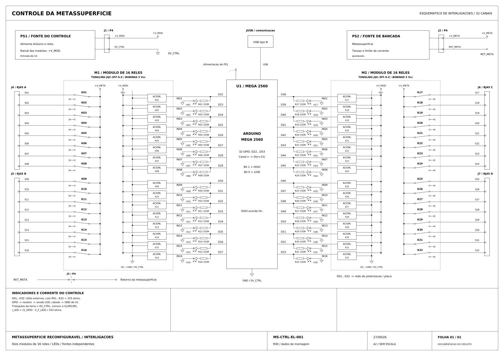

# Sistema de controle da metassuperfície

Arduino Mega 2560, dois módulos de 16 relés e 32 canais de controle. Desenho MS-CTRL-EL-001, revisão R00, data 27/09/26.

## Arquivos

| Arquivo | Conteúdo |
| --- | --- |
| [esquematico_completo.pdf](esquematico_completo.pdf) | Desenho vetorial em formato A2 |
| [esquematico_completo.dxf](esquematico_completo.dxf) | Desenho editável para AutoCAD |
| [esquematico_completo.svg](esquematico_completo.svg) | Visualização vetorial no GitHub |
| [esquematico_completo.png](esquematico_completo.png) | Imagem completa em alta resolução |
| [sistema_controle_artigo.png](sistema_controle_artigo.png) | Figura compacta com agrupamento dos canais e circuito de um canal |

## Alimentação e conexões

| Identificação | Função |
| --- | --- |
| U1 | Arduino Mega 2560 |
| M1 / M2 | Módulos de 16 relés |
| PS1 | Alimentação do Arduino e dos módulos |
| PS2 | Fonte de bancada para polarização da metassuperfície |
| +V_MOD / 0V_CTRL | Alimentação dos módulos e referência do controle |
| +V_META / RET_META | Alimentação e retorno da metassuperfície |
| J4 / J5 / J6 / J7 | Conectores RJ45 para os grupos S01–S08, S09–S16, S17–S24 e S25–S32 |
| R01–R32 / H01–H32 | Resistores de 333 Ω e LEDs indicadores |

Cada GPIO se conecta à entrada IN do módulo e ao resistor de seu LED indicador. O cátodo do LED se conecta a 0V_CTRL. Os contatos COM recebem +V_META; os contatos NC se conectam às saídas S01–S32. RET_META é o retorno da alimentação da metassuperfície.

## Mapeamento dos canais

| Canal | GPIO | Módulo | Entrada | Saída |
| --- | --- | --- | --- | --- |
| 01 | D22 | M1 | IN01 | S01 |
| 02 | D23 | M1 | IN02 | S02 |
| 03 | D24 | M1 | IN03 | S03 |
| 04 | D25 | M1 | IN04 | S04 |
| 05 | D26 | M1 | IN05 | S05 |
| 06 | D27 | M1 | IN06 | S06 |
| 07 | D28 | M1 | IN07 | S07 |
| 08 | D29 | M1 | IN08 | S08 |
| 09 | D30 | M1 | IN09 | S09 |
| 10 | D31 | M1 | IN10 | S10 |
| 11 | D32 | M1 | IN11 | S11 |
| 12 | D33 | M1 | IN12 | S12 |
| 13 | D34 | M1 | IN13 | S13 |
| 14 | D35 | M1 | IN14 | S14 |
| 15 | D36 | M1 | IN15 | S15 |
| 16 | D37 | M1 | IN16 | S16 |
| 17 | D38 | M2 | IN01 | S17 |
| 18 | D39 | M2 | IN02 | S18 |
| 19 | D40 | M2 | IN03 | S19 |
| 20 | D41 | M2 | IN04 | S20 |
| 21 | D42 | M2 | IN05 | S21 |
| 22 | D43 | M2 | IN06 | S22 |
| 23 | D44 | M2 | IN07 | S23 |
| 24 | D45 | M2 | IN08 | S24 |
| 25 | D46 | M2 | IN09 | S25 |
| 26 | D47 | M2 | IN10 | S26 |
| 27 | D48 | M2 | IN11 | S27 |
| 28 | D49 | M2 | IN12 | S28 |
| 29 | D50 | M2 | IN13 | S29 |
| 30 | D51 | M2 | IN14 | S30 |
| 31 | D52 | M2 | IN15 | S31 |
| 32 | D53 | M2 | IN16 | S32 |
